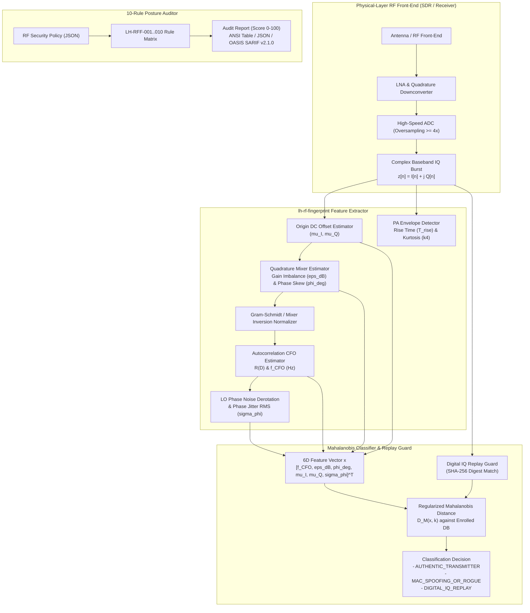

# lh-rf-fingerprinter (`lh-rf-fingerprint`)

[](https://github.com/Logihertz-Systems-OPC-Pvt-Ltd/lh-rf-fingerprinter/actions/workflows/ci.yml)
[](LICENSE)
[](https://python.org/)
[-success.svg)](pyproject.toml)
[](https://docs.oasis-open.org/sarif/sarif/v2.1.0/sarif-v2.1.0.html)

A production-grade, zero-external-dependency **Python 3.11+ Physical-Layer RF Transmitter Fingerprinting Engine, IQ Imbalance / CFO / Phase Noise Feature Extractor, Mahalanobis Device Classifier, and 10-Rule RF Physical-Layer Security Posture Auditor**.

Developed as Repository #47 of the Logihertz 60-Tool Open-Source Ecosystem.

---

## Table of Contents
- [Key Features](#key-features)
- [System Architecture](#system-architecture)
- [Mathematical Formulations](#mathematical-formulations)
  - [1. Origin DC Carrier Leakage](#1-origin-dc-carrier-leakage)
  - [2. Quadrature Mixer IQ Imbalance](#2-quadrature-mixer-iq-imbalance)
  - [3. Lag-D Autocorrelation CFO Estimation](#3-lag-d-autocorrelation-cfo-estimation)
  - [4. LO Phase Noise RMS & PA Envelope Kurtosis](#4-lo-phase-noise-rms--pa-envelope-kurtosis)
  - [5. Regularized Mahalanobis Distance Classifier](#5-regularized-mahalanobis-distance-classifier)
- [10-Rule RF Physical-Layer Security Posture Auditor](#10-rule-rf-physical-layer-security-posture-auditor)
- [Installation & Build](#installation--build)
- [CLI Reference & Usage](#cli-reference--usage)
- [Verification & Testing](#verification--testing)
- [License & Attribution](#license--attribution)

---

## Key Features

- **100% Zero External Runtime Dependencies**: Built strictly using the Python 3.11+ standard library (`math`, `cmath`, `hashlib`, `statistics`, `argparse`, `pathlib`, `dataclasses`, `typing`). No NumPy, SciPy, or scikit-learn required at runtime.
- **Physical-Layer Radiometric Hardware Biometrics**: Extracts unique silicon fabrication analog imperfections from complex baseband IQ bursts:
  - Carrier Frequency Offset (CFO) via lag-$D$ autocorrelation.
  - Quadrature mixer IQ amplitude gain imbalance ($\hat{\epsilon}_{\text{dB}}$) and phase skew ($\hat{\phi}_{\text{skew, deg}}$).
  - Origin / carrier leak DC offsets ($\hat{\mu}_I, \hat{\mu}_Q$).
  - Local Oscillator (LO) phase noise residual RMS ($\sigma_{\phi,\text{rms}}$).
  - Power Amplifier (PA) turn-on transient rise time ($T_{\text{rise, us}}$) between 10% and 90% steady-state amplitude.
  - 4th-order envelope kurtosis ($\kappa_4$).
- **Mahalanobis Transmitter Classifier & Anomaly Detector**: Authenticates emitters against enrolled 6D biometric profiles using regularized Mahalanobis distance ($D_M$), detecting Layer-2 MAC address spoofing and rogue Software-Defined Radios (SDRs).
- **Exact Digital IQ Waveform Replay Detection**: Identifies replayed physical-layer transmissions via deterministic SHA-256 sample digests and noise floor verification.
- **10-Rule Physical-Layer Security Posture Auditor**: Automated compliance scanner evaluating radio receiver configurations against normative rules (`LH-RFF-001` through `LH-RFF-010`) with ANSI table, Canonical JSON, and OASIS SARIF v2.1.0 exports.

---

## System Architecture



---

## Mathematical Formulations

### 1. Origin DC Carrier Leakage
DC offsets represent local oscillator feedthrough and direct-conversion mixer leakage:
$$\hat{\mu}_I = \frac{1}{N}\sum_{n=0}^{N-1} I[n], \qquad \hat{\mu}_Q = \frac{1}{N}\sum_{n=0}^{N-1} Q[n]$$

The DC-centered baseband components are defined as:
$$\tilde{I}[n] = I[n] - \hat{\mu}_I, \qquad \tilde{Q}[n] = Q[n] - \hat{\mu}_Q$$

### 2. Quadrature Mixer IQ Imbalance
Quadrature mixers exhibit silicon gain mismatch and non-orthogonal phase splitting:
$$\sigma_I = \sqrt{\frac{1}{N}\sum_{n=0}^{N-1} \tilde{I}[n]^2}, \qquad \sigma_Q = \sqrt{\frac{1}{N}\sum_{n=0}^{N-1} \tilde{Q}[n]^2}$$
$$\hat{\epsilon}_{\text{dB}} = 20 \log_{10}\left(\frac{\sigma_I}{\sigma_Q + 10^{-12}}\right)$$
$$\hat{\phi}_{\text{skew, deg}} = \frac{180.0}{\pi} \arcsin\left(\text{clamp}\left(\frac{\frac{1}{N}\sum_{n=0}^{N-1} \tilde{I}[n]\tilde{Q}[n]}{\sigma_I \sigma_Q + 10^{-12}}, \; -1.0, \; +1.0\right)\right)$$

### 3. Lag-$D$ Autocorrelation CFO Estimation
Given the mixer-compensated complex signal $s[n] = \tilde{I}_{\text{orth}}[n] + j \tilde{Q}_{\text{orth}}[n]$:
$$R(D) = \sum_{n=D}^{N-1} s[n] \cdot s^*[n-D]$$
$$\hat{f}_{\text{CFO}} = \frac{f_s}{2\pi D} \text{atan2}\left(\text{Im}(R(D)), \; \text{Re}(R(D))\right)$$

### 4. LO Phase Noise RMS & PA Envelope Kurtosis
Instantaneous phase residuals after CFO derotation are unwrapped, detrended to remove residual linear frequency drift, and evaluated for RMS phase jitter:
$$\sigma_{\phi,\text{rms}} = \sqrt{\frac{1}{N}\sum_{n=0}^{N-1} \psi_{\text{residual}}[n]^2} \cdot \frac{180.0}{\pi}$$

Power Amplifier (PA) turn-on transient rise time $T_{\text{rise, us}}$ measures the duration for instantaneous envelope $A[n] = \sqrt{I[n]^2 + Q[n]^2}$ to transition from 10% to 90% of steady-state amplitude $A_{\text{steady}}$:
$$T_{\text{rise, us}} = \frac{n_{90} - n_{10}}{f_s} \cdot 10^6$$

Normalized 4th-order envelope kurtosis:
$$\kappa_4 = \frac{\frac{1}{N}\sum_{n=0}^{N-1} (A[n] - \mu_A)^4}{\sigma_A^4 + 10^{-12}}$$

### 5. Regularized Mahalanobis Distance Classifier
Each burst is represented by the 6-dimensional feature vector:
$$\mathbf{x} = \left[\hat{f}_{\text{CFO}}, \; \hat{\epsilon}_{\text{dB}}, \; \hat{\phi}_{\text{skew, deg}}, \; \hat{\mu}_I, \; \hat{\mu}_Q, \; \sigma_{\phi,\text{rms}}\right]^T$$

For an enrolled transmitter profile $k$ with mean vector $\boldsymbol{\mu}_k$ and variance vector $\boldsymbol{\sigma}_k^2$:
$$D_M(\mathbf{x}, k) = \sqrt{\sum_{i=1}^{6} \frac{\left(x_i - \mu_{k,i}\right)^2}{\sigma_{k,i}^2 + \epsilon_{\text{reg}}}}$$

An observed transmission claiming identity $k$ is authenticated if and only if $D_M(\mathbf{x}, k) \le \tau_{\text{threshold}}$ (default $\tau = 3.5$). If claimed identity fails this threshold, `"MAC_SPOOFING_OR_ROGUE_TRANSMITTER"` is flagged.

---

## 10-Rule RF Physical-Layer Security Posture Auditor

| Rule ID | Severity | Deduction | CWE | Invariant Evaluated | Remediation Guidance |
|:---|:---:|:---:|:---:|:---|:---|
| **LH-RFF-001** | CRITICAL | -25 | CWE-290 | `rf_fingerprinting_enabled == true` && `allow_mac_only_fallback == false` | Enforce physical-layer RF fingerprinting; disallow unauthenticated MAC fallback. |
| **LH-RFF-002** | CRITICAL | -25 | CWE-682 | `mahalanobis_threshold <= 5.0` | Bound Mahalanobis decision boundary to prevent SDR impersonation ($\tau \le 5.0$). |
| **LH-RFF-003** | CRITICAL | -25 | CWE-294 | `iq_replay_detection_enabled == true` && `bind_phy_fingerprint_to_crypto_auth == true` | Enforce digital IQ burst replay checks and bind physical biometrics to crypto auth. |
| **LH-RFF-004** | HIGH | -10 | CWE-20 | `min_snr_db >= 15.0` | Gate burst processing on receiver SNR threshold ($\ge 15.0\text{ dB}$). |
| **LH-RFF-005** | HIGH | -10 | CWE-682 | All 4 impairment classes enabled (IQ imbalance, CFO, LO noise, PA transient) | Enable comprehensive multi-feature extraction across all analog domains. |
| **LH-RFF-006** | HIGH | -10 | CWE-367 | `temperature_drift_compensation == true` && `rx_gpsdo_locked == true` | Calibrate receiver clock using GPSDO reference and thermal drift compensation. |
| **LH-RFF-007** | HIGH | -10 | CWE-353 | `fingerprint_db_signed == true` && `allow_unauthenticated_enrollment == false` | Sign transmitter profile database and disallow unauthenticated runtime enrollment. |
| **LH-RFF-008** | MEDIUM | -4 | CWE-682 | `min_burst_samples >= 512` && `oversampling_factor >= 4` | Ensure adequate preamble sample window and ADC oversampling ratio. |
| **LH-RFF-009** | MEDIUM | -4 | CWE-400 | `multipath_channel_normalization == true` | Normalize multipath channel distortion prior to constellation feature extraction. |
| **LH-RFF-010** | LOW | -1 | CWE-778 | `log_rogue_tx_alerts == true` && `capture_forensic_iq_on_reject == true` | Enable SIEM alert forwarding and forensic raw IQ capture upon burst rejection. |

Security Posture Score:
$$S_{\text{posture}} = \max\left(0, 100 - \sum_{i=1}^{10} d_i \cdot \mathbf{1}_{\{\text{Rule}_i \text{ failed}\}}\right)$$

---

## Installation & Build

### Prerequisites
- Python 3.11, 3.12, or 3.13
- Linux, macOS, or Windows

### Clone and Install
```bash
git clone https://github.com/Logihertz-Systems-OPC-Pvt-Ltd/lh-rf-fingerprinter.git
cd lh-rf-fingerprinter
pip install -e .
```

Verify installation:
```bash
lh-rf-fingerprint --version
# Output:
# lh-rf-fingerprint v0.1.0
# Copyright (C) 2026 Logihertz Systems (OPC) Private Limited
```

---

## CLI Reference & Usage

### 1. `scan`: Audit Physical-Layer RF Security Policy
```bash
# Terminal table view
./bin/lh-rf-fingerprint scan fixtures/hardened_rff_policy.json

# Export in canonical JSON format
./bin/lh-rf-fingerprint scan fixtures/hardened_rff_policy.json --format json

# Export in OASIS SARIF v2.1.0 format
./bin/lh-rf-fingerprint scan fixtures/hardened_rff_policy.json --format sarif --output sarif_report.json
```

### 2. `extract`: Radiometric Biometric Feature Extraction
```bash
./bin/lh-rf-fingerprint extract fixtures/sample_rf_burst.json
```

Output:
```
===================================================================
      PHYSICAL-LAYER RF TRANSMITTER BIOMETRIC FEATURE EXTRACTION   
===================================================================
 Transmitter ID         : TX-ALPHA-01
 Sample Count           : 4096
 Carrier Freq Offset    : +1249.53 Hz
 IQ Gain Imbalance      : +0.5070 dB
 IQ Phase Skew          : +3.1417 deg
 DC Offset (I branch)   : +0.03980
 DC Offset (Q branch)   : -0.02994
 LO Phase Noise (RMS)   : 1.3394 deg
 PA Rise Time (10%-90%) : 79.00 us
 Envelope Kurtosis (k4) : 44.2124
 Burst SHA-256 Digest   : 2d62e3231360fc13eca5c427a928944a5487409eeae316996c25f18f7a2bcd2e
 6D Classification Vec  : [1249.5318, 0.507, 3.1417, 0.0398, -0.0299, 1.3394]
===================================================================
```

### 3. `verify-tx`: Authenticate Emitter & Detect MAC Spoofing
```bash
# Verify authentic transmitter
./bin/lh-rf-fingerprint verify-tx \
  --burst fixtures/sample_rf_burst.json \
  --db fixtures/enrolled_transmitters_db.json \
  --claimed-id TX-ALPHA-01

# Detect MAC spoofing (adversary claims TX-BRAVO-02 while exhibiting TX-ALPHA-01 hardware biometrics)
./bin/lh-rf-fingerprint verify-tx \
  --burst fixtures/sample_rf_burst.json \
  --db fixtures/enrolled_transmitters_db.json \
  --claimed-id TX-BRAVO-02
```

### 4. `synth-burst`: Synthesize Impaired RF Bursts
```bash
./bin/lh-rf-fingerprint synth-burst \
  --cfo-hz 1250.0 \
  --iq-gain-db 0.50 \
  --iq-skew-deg 3.0 \
  --dc-i 0.04 \
  --dc-q -0.03 \
  --samples 4096 \
  --output my_burst.json
```

---

## Verification & Testing

Execute the comprehensive test suite with unittest:
```bash
# Syntax and bytecode compilation
python3 -m py_compile src/lh_rf_fingerprinter/*.py tests/*.py

# Run test suite
PYTHONPATH=src python3 -m unittest discover -s tests -v
```

---

## License & Attribution

`lh-rf-fingerprinter` is licensed under the **Apache License, Version 2.0**.
See [LICENSE](LICENSE) and [NOTICE](NOTICE) for full terms.

Copyright (C) 2026 Logihertz Systems (OPC) Private Limited.  
Created, Architected, and Developed by **Sameer Tawade** (`ops@logihertz.com`).
